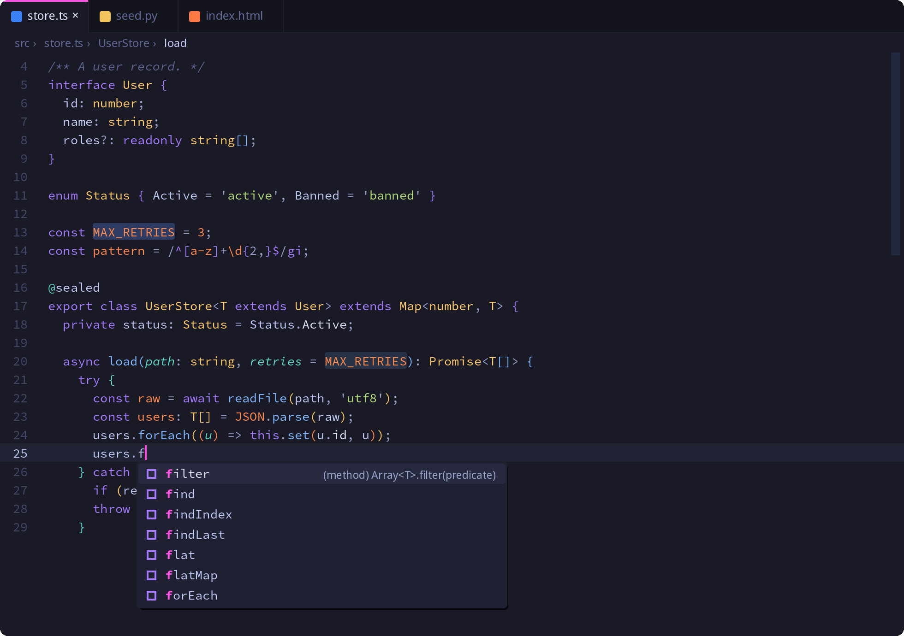

# Tokyo Midnight

A dark theme with purple accents. Good for late night coding.



## Why it's not on the marketplace

I made this theme for my own setup and it changes whenever I feel like it. Publishing it would mean maintaing it which isn't what this is.

## Install

Clone the repo into your extensions folder:

For VSCode:
```bash
git clone https://github.com/Vikmanou/Tokyo-Midnight ~/.vscode/extensions/tokyo-midnight
```

For Cursor:
```bash
git clone https://github.com/Vikmanou/Tokyo-Midnight ~/.cursor/extensions/tokyo-midnight
```

For Antigravity:
```bash
git clone https://github.com/Vikmanou/Tokyo-Midnight ~/.antigravity/extensions/tokyo-midnight
```

Restart the editor, run **Preferences: Color Theme** and pick **Tokyo Midnight**.

Using a different build? Swap the folder:

- VSCodium: `~/.vscode-oss/extensions/`
- VS Code (Flatpak): `~/.var/app/com.visualstudio.code/data/vscode/extensions/`
- Windows: `%USERPROFILE%\.vscode\extensions\`

## License

[MIT](LICENSE)
